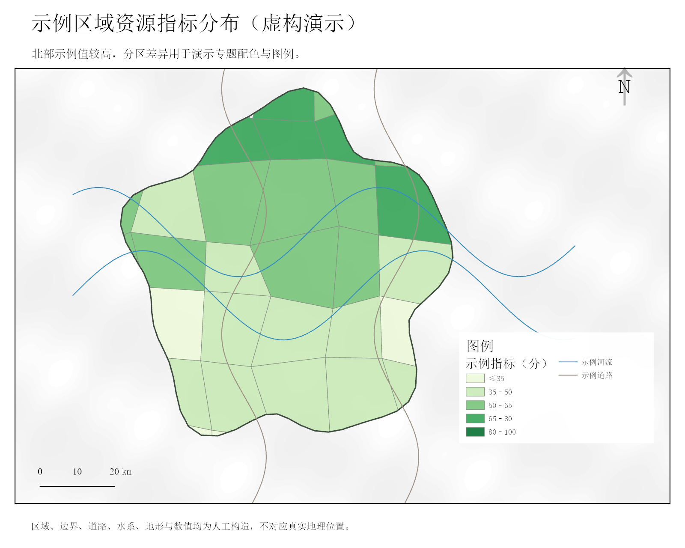
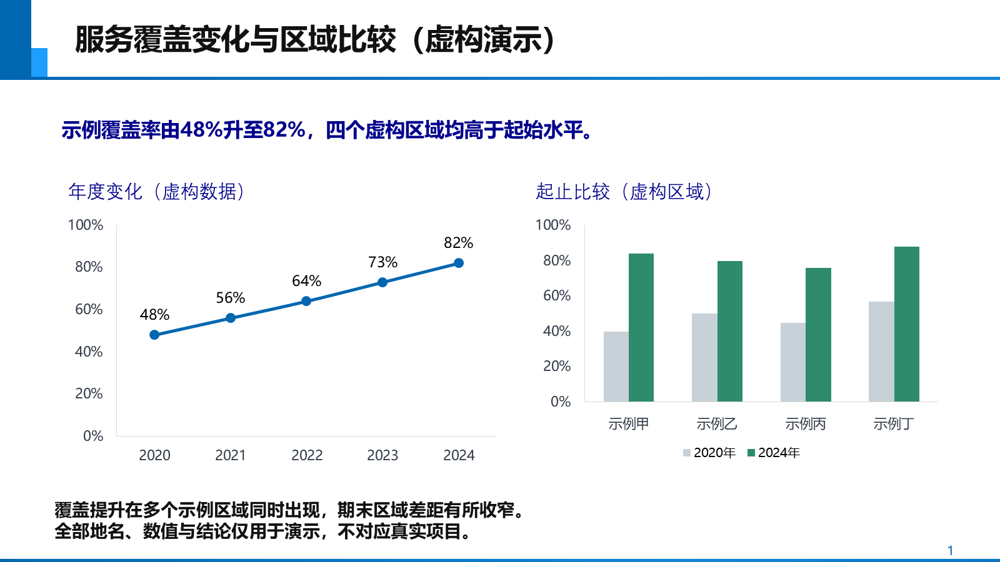

# LEEZY Skills

**Practical skills by [BigWai1312](https://github.com/BigWai1312).**

> **作者水印 / Attribution** · LEEZY Skills · BigWai1312
>
> **官方源地址**：https://github.com/BigWai1312/leezy-skills

面向 Codex 的个人技能集合，将实际工作中形成的方法整理成可复用、可检查的 Skill。当前包含 3 个技能，集合版本为 **v1.2.0**；本仓库不包含任何实际项目数据。

## 技能目录

| 技能 | 用途 | 调用方式 | 安装路径 |
| --- | --- | --- | --- |
| [LEEZY MapCraft](skills/leezy-mapcraft/README.md) | GIS 制图：自动补齐基础数据与 DEM、全国区位小图、适度晕渲及可编辑版式 | `$leezy-mapcraft` | `skills/leezy-mapcraft` |
| [LEEZY DOCX](skills/leezy-docx/README.md) | 中文报告排版：Markdown 优先、独立命名样式、自动目录、透明底色三线表与跨页续表 | `$leezy-docx` | `skills/leezy-docx` |
| [LEEZY SlideCraft](skills/leezy-slidecraft/README.md) | 专业演示与汇报制作：大纲确认、Markdown草稿确认、模板适配与可编辑PPT交付 | `$leezy-slidecraft` | `skills/leezy-slidecraft` |

集合名称是 **LEEZY Skills**，具体技能显示名称统一为 **LEEZY + 英文功能名**。集合本身不是一个可调用技能，请使用表格中的调用名。

## 效果预览

以下图片均为本次新建的**虚构演示**。地图的区域、地形、道路与水系均为人工构造；报告和PPT只使用虚构条目与测试数值，不是实际项目成果。图片内也保留演示声明，详细口径见 [示例说明](docs/demo-gallery.md)。

### LEEZY MapCraft：专题图

展示专题分级、边界层级、蓝色水系、图例和比例尺。虚构区域没有真实地理位置，因此不添加会造成误解的全国定位图。



### LEEZY DOCX：报告排版

展示中文命名样式、透明底色三线表、原生公式、自动题注和交叉引用。图片为Word实际导出的报告页。


### LEEZY SlideCraft：成果汇报

展示蓝白主题、上方引句、中部可编辑图表和下方结论。示例数据仅用于展示排版，不代表真实改善。



## 安装

在具备 `skill-installer` 的 Codex 中发送：

```text
$skill-installer
从 GitHub 仓库 BigWai1312/leezy-skills 安装技能：
路径 skills/leezy-mapcraft，名称 leezy-mapcraft。
路径 skills/leezy-docx，名称 leezy-docx。
路径 skills/leezy-slidecraft，名称 leezy-slidecraft。
```

也可以下载 [Releases](https://github.com/BigWai1312/leezy-skills/releases/latest) 中的 `leezy-mapcraft.zip`、`leezy-docx.zip` 或 `leezy-slidecraft.zip`，解压后将对应技能文件夹放入客户端使用的 Skills 目录。使用本地 Codex installer 默认目录时，结构为：

```text
<CODEX_HOME>/skills/leezy-mapcraft/SKILL.md
<CODEX_HOME>/skills/leezy-mapcraft/agents/openai.yaml
<CODEX_HOME>/skills/leezy-docx/SKILL.md
<CODEX_HOME>/skills/leezy-docx/agents/openai.yaml
<CODEX_HOME>/skills/leezy-slidecraft/SKILL.md
<CODEX_HOME>/skills/leezy-slidecraft/agents/openai.yaml
```

未设置 `CODEX_HOME` 时，这一 installer 使用用户主目录下的 `.codex/skills`。如果客户端配置为 `.agents/skills`，使用该客户端实际扫描的目录即可，不要同时安装同名副本。解压后不能多嵌套一层 `leezy-mapcraft`。

`leezy-skills.zip` 是整个集合的分享包；需要手工安装时，从其中 `skills/` 选择具体技能文件夹，不能把整个集合当作单个 Skill。

安装后在下一轮对话调用；客户端未刷新时重新打开会话。已有同名安装时，先保留本地自定义版本再更新，避免直接覆盖自己的修改。

SlideCraft 的三阶段确认流程与更多安装说明见 [使用说明](skills/leezy-slidecraft/README.md)。发布包中的 `SHA256SUMS.txt` 可用于核对下载文件是否完整。

## 快速调用

```text
$leezy-mapcraft
用 ArcGIS Pro 为 <研究区> 做一张 <指标名称> 的乡镇专题图。
乡镇面：<本地面图层路径>；编码字段：<字段名>
指标表：<本地表格路径>；连接字段：<字段名>
指标字段：<字段名>；单位：<单位>；年份：<年份>
DEM：<本地栅格路径>；水系：<本地图层路径>；道路：<本地图层路径>
ArcPy 环境：<python.exe 路径>；输出目录：<目录>
先核对连接结果、缺失值及单位，再出一张样图。
采用清爽底图、双列图例和经纬度图廓，保留可编辑 APRX。
导出 PNG 预览和 600 dpi JPG，不修改源数据，不插入 Word。
```

更多调用示例见 [基础数据准备、制图、改图与手工教程](skills/leezy-mapcraft/examples.md)。MapCraft 1.2.0 支持先查本地、再自动获取缺失基础数据，默认准备研究区外包矩形长边1.4倍的正方形周边范围，概况图按1.2倍范围显示。只列清单时不下载，专题指标由用户自行准备时不扩入基础数据任务。调用示例是输入模板，效果预览则是明确标注的虚构演示，两者均不是实际项目验证结果。

报告排版调用：

```text
$leezy-docx
把技能包中的 examples/sample-report.md 排成工作目录里的 sample-report.docx。
使用“修改的XXX”命名样式、自动目录和透明底色三线表。
表头黑体、表内宋体，独立样式；更新编号及引用并检查渲染结果。
```

输入要求与更多实例见 [LEEZY DOCX 使用说明](skills/leezy-docx/README.md)。

演示汇报调用：

```text
$leezy-slidecraft
根据我的报告先起草汇报大纲，确认后写逐页Markdown草稿，
再次确认后制作PPT。沿用蓝白汇报模板，每页引句与总结各有侧重，
突出图表与结论，右下角使用自动页码，方便以后继续加页。
```

更多新建、改稿、合并和审查示例见 [LEEZY SlideCraft](skills/leezy-slidecraft/README.md)。

## 运行条件

Skill 是给 AI 助手读取的工作规范，不是 ArcGIS 插件或一键运行程序。实际自动制图需要可用的文件和执行工具、ArcGIS Pro 许可及匹配的 ArcPy 环境；只有普通聊天能力时，可据此生成教程或脚本，但不能声称已经生成本地工程。

DOCX 技能也不内置 Word 插件或一键转换器。生成报告需要文件执行能力与文档处理工具，更新域和版式核验需要可用的 Word 等排版环境及字体；无法执行的检查必须明确说明。

SlideCraft 提供工作规范、去项目化PPTX模板与可选页码脚本，不是PowerPoint插件。实际制作与渲染需要相应工具；Windows页码脚本需要Microsoft PowerPoint。静态预览与GIF、平滑切换的实播检查分别说明。

“离线”指图件数据、本地 DEM 和底图可在离线 GIS 生产电脑使用，不代表仓库提供离线 AI 模型。安装需联网或事先下载 ZIP；Codex 模型服务的连接方式由使用者的环境决定。

## 署名与来源

- 作者账号：[BigWai1312](https://github.com/BigWai1312)。
- 唯一维护入口：[BigWai1312/leezy-skills](https://github.com/BigWai1312/leezy-skills)。
- 署名位于本页、每个 Skill、`agents/openai.yaml` 所对应的显示名称及包内 `NOTICE.md`；不包含私人邮箱或个人电脑路径。
- Skill 的版权声明与用户地图、报告的数据来源分开。默认不在用户成果上加品牌水印；主动要求时可加可编辑的品牌及来源文字。
- 使用 MIT License，完整条款见 [LICENSE](LICENSE)；分发副本时保留其中的版权及许可声明。建议同时保留 [NOTICE.md](NOTICE.md)，便于追溯来源。

水印和来源文字用于标识出处，不是防复制或防篡改机制。

## 旧版迁移

旧仓库 `BigWai1312/arcgis-map-craft` 的版本和 `$arcgis-map-craft` 调用名保留用于历史使用。新版请从本集合安装，并改用 `$leezy-mapcraft`。旧名不是新技能的自动别名；确认新版可用后可自行移除旧安装，避免自动选择时混淆。

## 维护与更新

修改对应 `skills/<skill-name>/SKILL.md` 中的规范及 `agents/openai.yaml` 中的界面信息，同步相应教程和示例。后续新增技能放在 `skills/<skill-name>/`，并在本页登记；不要把尚未完成的技能列为可用。

```powershell
git add README.md NOTICE.md LICENSE skills
git commit -m "Update MapCraft guidance"
git push origin main
```

推送到 GitHub 不会自动更新使用者的本地安装，也不会自动替换 Releases 中的附件。发布新版本时更新版本说明，从同一提交打包并验证，再创建对应 tag 和 Release，上传三个独立技能包、集合包及校验文件；最后核对在线附件。每个 ZIP 都应排除 `.git`、私有构建文件、实际项目数据和本地路径。保留旧版Release，不将旧附件静默覆盖为新版本。

调用规范参考：[Codex Skills 文档](https://developers.openai.com/codex/skills/)。本仓库是个人项目，与 OpenAI、Esri 无官方隶属关系。

---

**LEEZY Skills · BigWai1312 · https://github.com/BigWai1312/leezy-skills**
