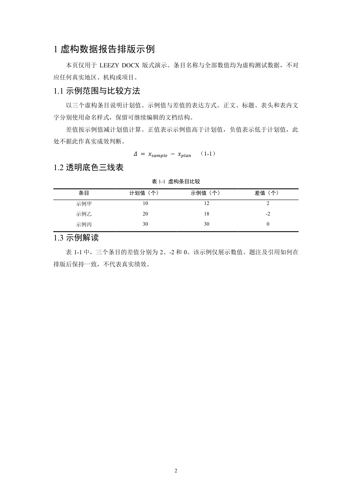

# LEEZY Skills

**GIS 制图、中文报告与成果汇报。**

作者：[BigWai1312](https://github.com/BigWai1312) · [仓库源地址](https://github.com/BigWai1312/leezy-skills) · [MIT 许可](LICENSE)

面向 GIS 制图、报告排版与演示制作的可复用 AI 工作规范。当前主分支集合版本为 **1.2.2**，包含 3 个可分别安装的技能。公开内容采用通用说明、占位输入与虚构演示，不包含用户项目材料。

## 技能目录

| 技能 | 版本 | 用途与交付 | 调用方式 |
| --- | --- | --- | --- |
| [LEEZY MapCraft](skills/leezy-mapcraft/README.md) | 1.2.2 | 补齐必要基础数据；独立制作概况图或专题图；交付可编辑 APRX 与图片 | `$leezy-mapcraft` |
| [LEEZY DOCX](skills/leezy-docx/README.md) | 1.0.0 | Markdown 优先；命名样式、自动目录、三线表、题注与引用；交付可维护 DOCX | `$leezy-docx` |
| [LEEZY SlideCraft](skills/leezy-slidecraft/README.md) | 1.0.0 | 大纲与逐页草稿确认；模板适配、原生图表与自动页码；交付可编辑 PPTX | `$leezy-slidecraft` |

LEEZY Skills 是集合名称，不是调用名。只需安装自己要使用的技能。

## 效果预览

DOCX 和 SlideCraft 的图片均使用虚构测试内容，生成方式与使用范围见 [示例说明](docs/demo-gallery.md)。MapCraft 的图件类型、制图规范与交付方式见 [技能说明](skills/leezy-mapcraft/README.md)，公开仓库不展示用户项目地图。

### DOCX · 中文报告排版

中文命名样式、透明底色三线表、原生公式、自动题注与交叉引用。图片由 Word 实际导出，条目和数值为虚构测试内容。



### SlideCraft · 成果汇报

蓝白主题、上方引句、中部可编辑图表和下方结论。图片由 PowerPoint 实际导出，示例数据不代表真实改善。


## 安装与更新

在具备 `skill-installer` 的 Codex 中发送，保留需要的技能行即可：

```text
$skill-installer
从 GitHub 仓库 BigWai1312/leezy-skills 的 main 分支安装技能：
路径 skills/leezy-mapcraft，名称 leezy-mapcraft。
路径 skills/leezy-docx，名称 leezy-docx。
路径 skills/leezy-slidecraft，名称 leezy-slidecraft。
```

已有同名安装时先保留本地自定义版本，再更新并重新打开会话。**当前修订位于 main；旧 Release 附件不会随推送更新。** 从 [Releases](https://github.com/BigWai1312/leezy-skills/releases) 下载 ZIP 时，请核对版本和说明。

手动安装时，将对应技能目录放到客户端实际扫描的 Skills 目录，结构为：

```text
<CODEX_HOME>/skills/leezy-mapcraft/SKILL.md
<CODEX_HOME>/skills/leezy-docx/SKILL.md
<CODEX_HOME>/skills/leezy-slidecraft/SKILL.md
```

目录中的 `agents/`、`references/`、`assets/` 等配套文件也要保留，不要只取 `SKILL.md`，不要多嵌套一层同名目录。未设置 `CODEX_HOME` 时，该 installer 默认使用用户主目录下的 `.codex/skills`；其他客户端以其实际配置为准，不要同时安装同名副本。集合 ZIP 需从 `skills/` 中选择具体技能，不能把整个集合当作单个 Skill。发布包可用配套 `SHA256SUMS.txt` 检查完整性。

## 快速调用

### 制作独立专题图

```text
$leezy-mapcraft
为 <研究区> 制作 <年份><指标名称> 专题图。
指标栅格或面图层：<路径>；指标字段：<如适用>；单位：<单位>。
基础地理数据：<目录或无>；输出目录：<目录>。
先核验指标与本地基础数据，自动补齐缺少的必要基础图层。
直接制作独立专题图，不先做概况图，不把概况图PNG/PDF当底图。
指标为主体，地形按需淡化或关闭；标题、图例与单位单独设置。
提供可编辑APRX、PNG/PDF和QA说明，保留源数据。
```

### 制作区域概况图

```text
$leezy-mapcraft
为 <研究区> 制作一张区域概况图，目前没有基础数据。
先查项目目录，自动补齐边界、DEM、水系、主要交通和地名。
DEM实际下载并核验，角落放全国区位图，周边按默认20%边长扩展显示。
地形起伏适中、图例不挡研究区，提供可编辑工程和PNG/PDF。
专题指标由我另行提供，这次不做专题图。
```

**两类地图共用基础数据，分别制作，没有前置依赖。** 只要数据清单时不下载；只准备基础数据时不额外制图。更多输入模板见 [MapCraft 调用参考](skills/leezy-mapcraft/examples.md)。

### 排版中文报告

```text
$leezy-docx
把技能包中的 examples/sample-report.md 排成工作目录里的 sample-report.docx。
使用“修改的XXX”命名样式、自动目录和透明底色三线表。
表头黑体、表内宋体，独立样式；更新编号及引用并检查渲染结果。
```

输入要求与更多实例见 [LEEZY DOCX 使用说明](skills/leezy-docx/README.md)。

### 制作成果汇报

```text
$leezy-slidecraft
根据我的报告先起草汇报大纲，确认后写逐页Markdown草稿，
再次确认后制作PPT。沿用蓝白汇报模板，每页引句与总结各有侧重，
突出图表与结论，右下角使用自动页码，方便以后继续加页。
```

更多新建、改稿、合并和审查示例见 [LEEZY SlideCraft](skills/leezy-slidecraft/README.md)。

## 运行条件与交付边界

技能是 AI 工作规范，不是软件插件或一键运行程序。安装技能不会自动安装 GIS、Office、Python 或字体。

| 技能 | 实际执行所需环境 |
| --- | --- |
| MapCraft | 文件与执行工具、ArcGIS Pro 许可、匹配的 ArcPy；数据获取阶段需可用网络或已有本地数据 |
| DOCX | 文档处理工具、目标字体；更新域及渲染检查需要 Word 等排版环境 |
| SlideCraft | PPTX 制作与渲染工具、目标字体；包内 Windows 页码脚本需要 PowerPoint |

“离线地图”指交付工程使用本地 GIS 数据，不代表离线 AI。只有聊天能力或环境不足时，助手应说明能交付的教程、脚本及未完成检查，不声称已经生成或验证工程。静态预览也不等于已验证 GIF、切换或实际放映。

## 来源与维护

技能采用 [MIT License](LICENSE)，分发副本时保留版权和许可声明及 [来源记录](NOTICE.md)。公开品牌与账号用于技能署名，不自动加到用户地图、报告或 PPT 上。第三方资料仍适用各自条款。

修改技能时同步入口提示、README、调用示例与来源说明。公开前检查正文、文件名、图片内容和元数据、Office 隐藏属性、提交署名及发布附件。使用通用占位符和独立演示材料，不带入用户身份、机构、具体研究主题、项目名称、原图指纹、制作记录、私人路径或凭据；不要在“未包含”的免责声明里复述这些信息。

更新公共技能的授权不等于公开用户成果的授权。展示素材须独立准备并明确其演示性质；版权与数据署名不能以脱敏为由删除。

推送只更新仓库，不会自动更新用户的本地安装或 Release 附件。发布新 Release 时，从同一提交打包并校验，保留旧版，不静默覆盖旧附件。

旧仓库 `BigWai1312/arcgis-map-craft` 及 `$arcgis-map-craft` 保留用于历史使用；新调用名为 `$leezy-mapcraft`，旧名不会自动成为别名。

本仓库为个人项目，与 OpenAI、Esri、Microsoft 无官方隶属关系。
