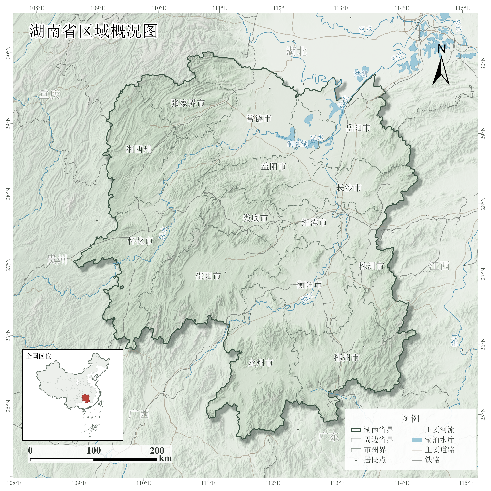

# 效果示例说明

这组图片用于介绍 LEEZY Skills 的实际输出形态。MapCraft 使用已完成的湖南概况图；DOCX 与 SlideCraft 使用虚构测试内容，不能把三者统一称为虚构成果或真实研究结果。

| 示例 | 图中材料 | 实际生成方式 | 不代表什么 |
| --- | --- | --- | --- |
| [MapCraft](../skills/leezy-mapcraft/README.md) | 湖南及周边行政边界、地形、水系、交通、地名与全国区位 | ArcGIS Pro 实际导出的 3804 × 3804 PNG，与完成版原图一致 | SDG 专题结果、30 m DEM、现状调查、审定标准地图或可直接加载的专题底图 |
| DOCX | 示例甲、乙、丙，计划值10/20/30，示例值12/18/30 | 创建Word命名样式、原生公式、SEQ/REF域与三线表，更新域后经Word导出页面 | 真实报告、真实成效或所有跨页情形均已验证 |
| SlideCraft | 2020至2024年测试序列48/56/64/73/82及四个虚构区域 | 在内置蓝白模板加入原生图表，经PowerPoint导出PNG | 真实服务覆盖数据、政策因果结论或动态放映效果 |

## MapCraft：实际概况图

展示完整湖南边界与适量周边、3.5 倍地形晕渲、整度坐标、图名光晕、市州界、全国区位小图及右下图例。旧的人工区域、数学纹理和虚构指标图不再作为当前技能效果示例。

来源为 GADM、Natural Earth、ArcGIS World Elevation / Terrain、GMT China geospatial data。地形约 450 m，水系仍缺资水、澧水，全国区位是研究示意。完整署名、参数、原图校验值和限制见技能包内的 [图片来源说明](../skills/leezy-mapcraft/references/preview-provenance.md)。

概况图与专题图是独立成果。复用的是经核验的基础数据或个别可编辑图层，不是这张 PNG，也不是概况图整套标题、图例、标注和地形。这里没有用虚构指标冒充尚未公开的专题图效果。

## DOCX 与 SlideCraft：虚构数据演示

PPT起始年四个区域的测试值为40、50、45、57，末年为84、80、76、88；等权均值分别为48和82，极差由17缩小为12。年度折线的中间值也为虚构测试值，不能用于真实趋势分析。

报告差值按示例值减计划值计算，为2、-2、0。题注、公式与引用保留为原生对象，截图本身仅是静态预览。

## 公开范围

公开内容包括湖南地图成果 PNG、虚构数据演示 PNG、技能说明和已去除项目内容的通用 PPTX 模板。底层地理数据、指标、原始报告、APRX/GDB、私有路径、个人元数据、构建日志及临时工程不进入仓库。

地图图片与第三方资料的来源条款保留在配套说明中；技能的 MIT 许可不覆盖或替代第三方权利。静态图片可以展示版式，不能证明 GIF 或切换已经实际播放，也不保证任意运行环境无需调整即可获得相同效果。历史 Release 保留当时的示例与说明，不随 main 分支更新。
