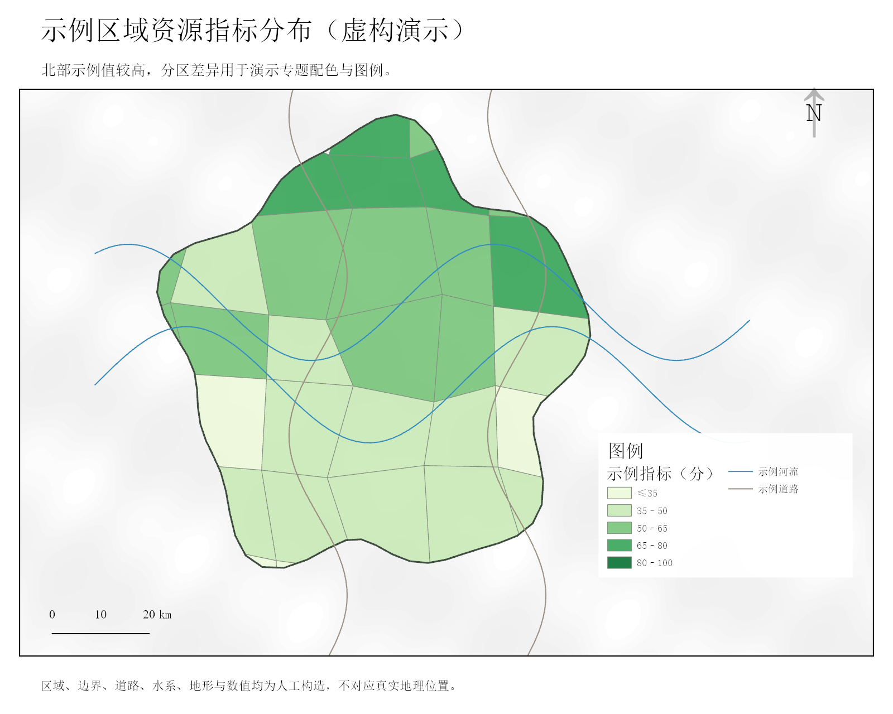

# LEEZY MapCraft

**GIS 精细制图 · LEEZY Skills · 作者 [BigWai1312](https://github.com/BigWai1312)**

官方源地址：https://github.com/BigWai1312/leezy-skills/tree/main/skills/leezy-mapcraft

适用于基础地理数据准备、ArcGIS Pro 区域概况图与专题图、现有工程版式调整及离线手工制图教程。规范包含缺失基础数据自动获取、实际 DEM 下载与核验、全国区位小图、适度地形晕渲、道路水系层级、指标配色、双列图例、经纬度图廓和可编辑交付；技能包不附带实际项目数据。

## 虚构演示



本图由ArcGIS Pro生成。区域形状、分区、道路、水系、背景纹理和指标数值均为人工构造，不对应真实地理位置；没有使用真实项目数据。示例仅展示专题图的图面组织，不用于真实空间分析，也不冒充真实DEM或已完成的数据采集成果。

## 安装与调用

在 Codex 中发送：

```text
$skill-installer 从 BigWai1312/leezy-skills 安装 skills/leezy-mapcraft。
```

安装后调用：

```text
$leezy-mapcraft
根据 <数据目录> 制作一张 <指标名称> 专题图。
指标字段为 <字段>，单位为 <单位>，输出到 <输出目录>。
先检查数据并出一张样图，提供可编辑 APRX 和图片预览。
```

详细输入及参考输出见 [examples.md](examples.md)。需要执行制图时，先发现已有可用 ArcPy 环境；环境不可用时说明具体阻碍。专题连接需要真实指标及对应字段，但缺少基础地理数据不要求用户自行全部找齐，也不编造空间分布或统计结论。

## 基础数据准备

- 先核查指定本地目录；用户要求准备数据或制作地图时，即使没有提供基础数据，也自动获取缺失的必要图层，不停在网站清单或重复询问已经授权的下载。
- 用户只要清单、建议或要求等待时，只列清单；更新技能、审图、教程和单纯改样式也不会触发下载。
- 采集范围与显示范围分开：默认按投影外包框长边 `1.4` 倍的正方形采集，概况图默认用 `1.2` 倍正方形显示，保留完整研究区并减少无用周边。都是边长比例，不是面积比例或每边外扩比例；用户明确指定的范围优先。
- 基础清单包括行政区及周边边界、DEM、河流、水面、主要交通和中文地名；县界作为细节备用，新做区域概况图默认准备独立的全国区位素材。所有主图环境图层覆盖采集范围，小图另定范围。
- DEM 必须真实下载为可打开的本地高程数据，检查分辨率、覆盖、NoData 和接缝；优先适合的约 30 m 数据。较粗数据只能按实际精度说明，服务导出或细网格重采样不能冒充高精度；用户明确要求的分辨率未达到时保留为未完成项。
- 专题指标由用户另行提供时，不收集或重算指标，不将土地覆盖分析、保护地、流域等专题资料自动扩入基础任务。
- 核验覆盖、几何、位置偏移、名称、分类、年份和来源许可；保留原件、哈希、制图副本及 QA 记录，明确区分“已下载”和“已核验”。

操作规范见 [基础地理数据准备](references/base-geography.md)。只准备数据时交付离线数据、范围、来源清单和核验记录，不强制生成 APRX。获取过程需要网络及可用工具；离线交付指处理后的底图不依赖在线图层。缺失凭据、受限来源或无法验证的数据会单独列出，不承诺任意来源都能自动下载。

## 概况图默认样式

- 小图：角落放全国区位图框，优先左下、主图比例尺上方，白底细边框、研究区醒目填色；避开主图研究区和阴影。全国素材需完整，不拿周边裁切图充当全国图。
- 图廓：省域等大范围优先整度经纬标注，少用半度和细分刻度；压缩纸面白边，但给四边坐标留足位置。
- 地形：以约 3 倍起步，3.5 倍可作中等起伏的参考。夸张系数与明暗对比一起微调，避免默认使用过重的 5 倍效果；原高程不变。
- 字体与边界：约 30 cm 图幅可从 28–30 pt 图名、2–3 pt 白色光晕、16 pt 市州名称起步；市州界约 0.8–1 pt，省界更突出。按最终印刷尺寸调整，不把参数固定到所有图幅。
- 图例：右下两列，面板左右约 12 pt、上下约 10 pt 内边距，整体避开研究区和装饰阴影；无专题值时按基础要素分组。
- 图面文字：不加无必要的左下角来源小字、处理说明或品牌水印，说明保存在配套文件；数据许可要求的可见署名仍须保留。
- 强调研究区时可用独立的柔和边界阴影，扣除真实研究区面，不改分析边界。局部改图只改用户要求的属性，保留已接受的版式并检查新版导出。

这些是新图的可调整默认值。已有工程按用户反馈局部修改，不自动重做版式或新增未要求的插图。

## 署名与水印

包内保留作者和来源声明，见 [NOTICE.md](NOTICE.md) 及 [LICENSE](LICENSE)。用户地图默认不加品牌水印。需要署名版预览时，可在任务中要求：

```text
在预览图空白角落加入可编辑的署名：
LEEZY MapCraft | BigWai1312 | github.com/BigWai1312/leezy-skills
不要遮挡图例、比例尺或地理要素。
```

仅有技能规范不等于已经完成制图；实际制图需要 ArcGIS Pro、有效许可、可用的本地执行工具及数据。版本：1.2.0。当前调用名为 `$leezy-mapcraft`，旧调用 `$arcgis-map-craft` 不会自动指向新版。

---

LEEZY MapCraft · BigWai1312 · https://github.com/BigWai1312/leezy-skills
