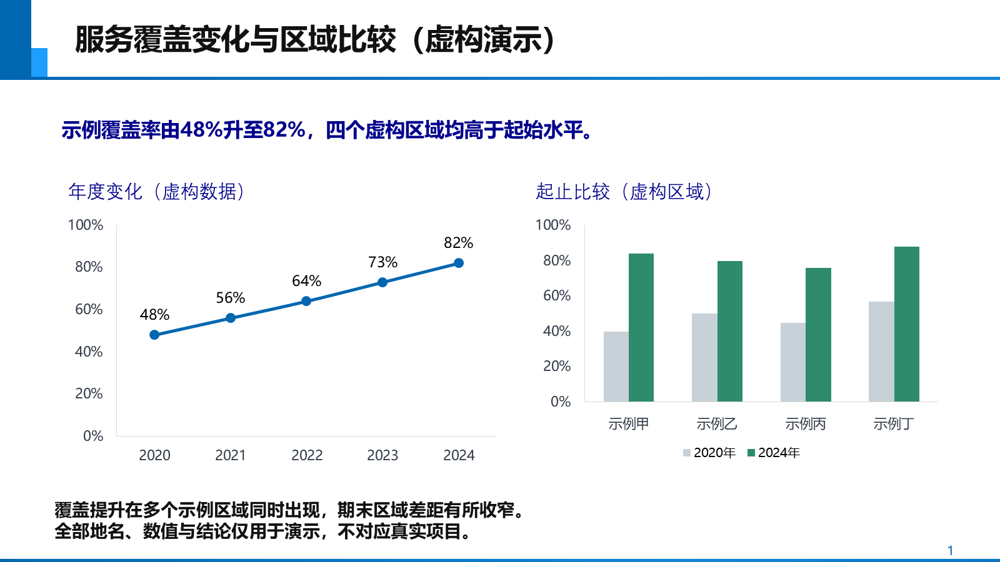
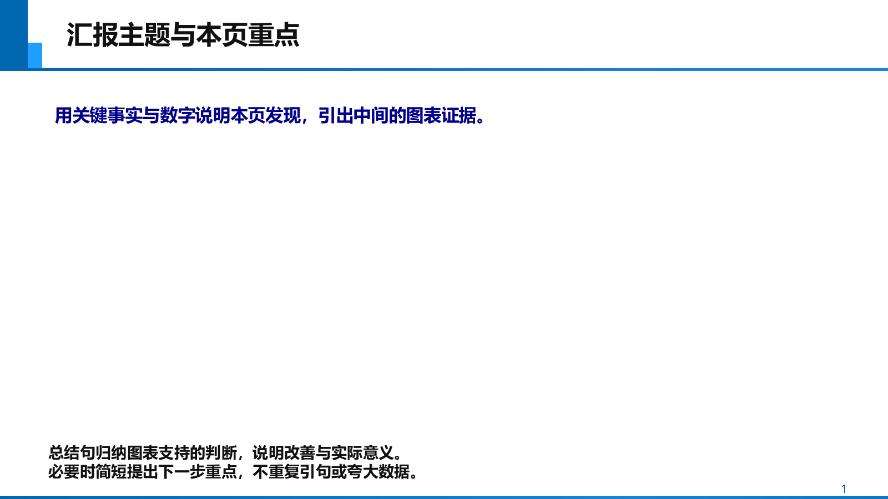

# LEEZY SlideCraft

**专业演示与汇报制作 · LEEZY Skills · 版本 1.0.0**

[技能源地址](https://github.com/BigWai1312/leezy-skills/tree/main/skills/leezy-slidecraft) · [作者 BigWai1312](https://github.com/BigWai1312) · [MIT 许可](LICENSE) · [来源声明](NOTICE.md)

把报告、论文、数据和现有材料整理为逻辑清楚、视觉统一、可以继续编辑的PPT，适合科研展示、项目汇报和答辩。

## 效果预览



示例采用内置模板，图表由虚构数值生成，再经PowerPoint实际导出。上方引句交代变化，中间图表提供证据，下方总结给出判断。全部区域名、数值与结论仅供演示，不对应真实项目。

## 三阶段工作方式

1. 先阅读材料，提交汇报大纲，等用户确认。
2. 大纲确认后写逐页Markdown草稿，再等用户确认。
3. 草稿确认后制作PPT，逐页检查并交付PPTX与预览。

普通的“帮我做PPT”按此流程开始。一句“可以”只确认当前阶段；明确提供批准的草稿或明确要求跳过阶段时，按用户授权继续，不重复询问。

局部改版、改页码、合并已有PPT和只读审查按实际要求执行，不强制从大纲重新开始。

## 默认模板



[可编辑模板](assets/blue-white-briefing.pptx) 使用16:9蓝白主题，保留左侧蓝色标题装饰、黑色标题、深蓝引句和黑色总结句。中间展示图表，右下角为母版自动页码。

模板不含实际项目数据、机构署名或品牌水印。它是一页内容样板，不强制新增封面，也不强制总页数。用户本次提供的模板优先。

## 安装与更新

在具备技能安装器的客户端输入：

```text
$skill-installer
从 BigWai1312/leezy-skills 的 main 分支安装 skills/leezy-slidecraft。
```

也可下载 [Releases](https://github.com/BigWai1312/leezy-skills/releases/latest) 中的 `leezy-slidecraft.zip`，解压后按下述结构放入Skills目录。

将本集合里的 `skills/leezy-slidecraft` 文件夹复制到客户端实际扫描的Skills目录，保持结构：

```text
<CODEX_HOME>/skills/leezy-slidecraft/SKILL.md
<CODEX_HOME>/skills/leezy-slidecraft/agents/openai.yaml
<CODEX_HOME>/skills/leezy-slidecraft/assets/blue-white-briefing.pptx
```

未设置 `CODEX_HOME` 时，Codex默认使用用户目录下的 `.codex/skills`；其他客户端按其实际配置安装。不要在多个扫描目录放同名副本，不要多嵌套一层目录。更新前保留本地自定义版本。

Windows本地集合示例：

```powershell
$collectionRoot = "你的LEEZY Skills集合目录"
$targetRoot = if ($env:CODEX_HOME) {
    Join-Path $env:CODEX_HOME "skills"
} else {
    Join-Path $env:USERPROFILE ".codex\skills"
}
$destination = Join-Path $targetRoot "leezy-slidecraft"
if (Test-Path -LiteralPath $destination) {
    throw "已有同名技能，请先检查并保留自定义版本。"
}
Copy-Item -LiteralPath (Join-Path $collectionRoot "skills\leezy-slidecraft") `
    -Destination $destination -Recurse
```

安装后在新一轮对话调用；客户端未刷新时重新打开会话。保留完整技能目录中的配套文件，更新前保留本地自定义版本。仓库推送不会自动更新本地安装或旧 Release 附件；下载 ZIP 时核对对应版本。

## 调用示例

### 从材料开始

```text
$leezy-slidecraft
根据我提供的报告，准备一份4页项目成果汇报。
沿用技能内置蓝白模板，第一页面向技术流程，其余页面突出结论。
先给大纲，我同意后再写Markdown草稿，最后再制作PPT。
```

### 大纲已同意

```text
$leezy-slidecraft
上轮的大纲已确认，继续写逐页Markdown草稿。
每页上面一句引句，中间以图表为主，下面给有结论性的总结。
两句不要重复，关键数字标清年份、单位和来源。这一步先不做PPT。
```

### 草稿已同意

```text
$leezy-slidecraft
这版Markdown已确认，开始制作PPT。
保持指定模板，保留原生图表和流程图，右下角用自动页码。
完成后给PPTX和静态预览，并检查所有页面。
```

### 合并已有成果

```text
$leezy-slidecraft
把这四份PPT按成果1至成果4合并，不大改正文和图表。
统一必要的标题、章节衔接和右下角自动页码。
后面还要加页，请测试新增、复制、删除和调序后的编号。
```

### 只审查

```text
$leezy-slidecraft
只检查这份PPT的主线、上下句是否重复，以及图表能否支撑结论。
先列出问题和修改建议，不改文件。
```

## 能力与边界

- 默认突出结果和实际意义，必要的方法用简短流程图说明。
- 地图和图表必须服务于结论；有真实可比年份时可做统一时间轴的多图GIS GIF。
- 不固定九宫格，不以小字堆砌内容，不把整页图片当可编辑PPT。
- 主体解释放备注，影响结论的口径限定与必需署名仍保留。
- 支持PPTX与静态预览。GIF和平滑切换的实际放映效果需在目标环境检查。
- 技能是工作规范、模板及一个可选原生页码辅助脚本，不是PowerPoint加载项或一键报告转换器。
- 首版不含视频、复杂动画编排、网页演示，也不随包分发项目数据。

实际制作需要文件执行能力、PPTX工具和字体。页码脚本需要Windows及已安装的Microsoft PowerPoint；其他环境可用相应原生页码方法，不虚报宿主验证。

署名与来源见 [NOTICE.md](NOTICE.md)，许可证见 [LICENSE](LICENSE)。作者信息属于技能，生成的用户PPT默认不强加品牌或作者水印。
